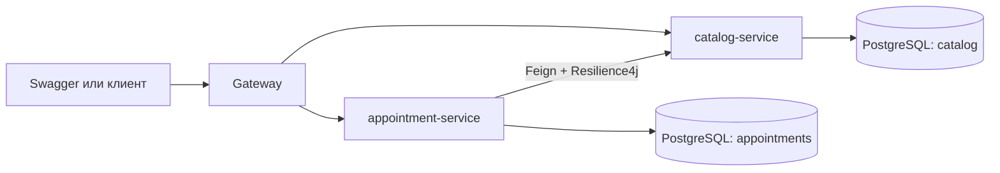

# Стоматология. Шпаргалка к защите ЛР №3

## Что сказать в начале

> Это сервис записи в стоматологию. Пациент выбирает врача и время, регистратор управляет записями, врач проводит приём и отмечает выполненные процедуры. В первой лабораторной реализовали эту логику в монолите. Во второй разделили каталог и приёмы на два микросервиса. В третьей довели до рабочего состояния вход по JWT и ролевую модель. Покажу, что супервайзер может создать пользователя, а пациент получает отказ при том же запросе и видит только свои записи.

## ЛР №1. Предметная модель и монолит

Одно Spring Boot приложение обрабатывало все запросы. Контроллер принимает и валидирует DTO, сервис применяет бизнес-правила, репозиторий читает и пишет данные. DTO определяет формат API, сущность — формат хранения. Liquibase создаёт и изменяет схему PostgreSQL, Swagger описывает REST API.

| Сущность | Что хранит |
|---|---|
| Пользователь | Имя, телефон, email, роль. У врача есть специализации, рабочие часы и список процедур |
| Стоматологическая процедура | Название, базовая цена, длительность, активность |
| Приём | Пациент, врач, начало и конец, комментарий и статус `SCHEDULED`, `COMPLETED` или `CANCELLED` |
| Выполненная процедура | Связь приёма с процедурой, количество, номер зуба, цена на момент добавления |

Один врач ведёт много приёмов. У одного приёма может быть много выполненных процедур. Врачи и доступные им процедуры связаны многие-ко-многим. Приёмы и процедуры тоже связаны многие-ко-многим, с дополнительными полями в строке выполненной процедуры. Изменение цены в каталоге поэтому не меняет стоимость ранее добавленной услуги.

При создании или переносе проверяются роли и активность участников, рабочие часы врача и пересечения как у врача, так и у пациента. Свободные окна вычисляются из рабочего дня и уже занятых интервалов. Перенос и отмена возможны для запланированного приёма.

## ЛР №2. Два бизнес-сервиса



| Компонент | Зачем нужен |
|---|---|
| `gateway` | Одна внешняя точка входа на порту 8080. Маршрутизирует запросы и собирает два описания API в одном Swagger |
| `eureka-server` | Реестр адресов сервисов. Gateway и Feign находят экземпляры по имени, например `catalog-service` |
| `config-server` | Отдаёт настройки из `config-repo/`. Здесь маршруты, адреса БД и Eureka, таймауты и настройки Circuit Breaker |
| `catalog-service` | Пользователи, процедуры и их назначения врачам. WebFlux + Spring Data R2DBC возвращают реактивные результаты |
| `appointment-service` | Записи, свободные окна и выполненные процедуры. WebFlux на входе, блокирующие JPA и Feign исполняются на `boundedElastic` вне сетевого event loop |
| PostgreSQL | Один контейнер, две базы. Каждый бизнес-сервис работает со своей базой |

**Путь создания приёма.** Gateway отправляет `POST /api/v1/appointments` в сервис приёмов. Через Feign он получает из каталога профили пациента и врача. В транзакции PostgreSQL берёт `pg_advisory_xact_lock` по UUID обоих участников, проверяет пересечения и сохраняет запись. Такая блокировка заставляет конкурентные попытки с одним и тем же врачом или пациентом пройти последовательно. При переносе также блокируется строка приёма. Уведомление пишется в лог после коммита.

У сервиса приёмов есть снимки имён пациента и врача, поэтому существующий приём можно прочитать при недоступности каталога. Для операции, которой нужны данные каталога, Resilience4j учитывает сбои, временно прекращает вызовы при превышении порога и возвращает `503`. Ответ каталога `404` по отсутствующему пользователю или процедуре обрабатывается отдельно.

**Пагинация.** У каталога обычные `page` и `size`, у списка процедур есть `X-Total-Count`. Приёмы листаются по `nextCursor`, в который входят время создания и UUID последней записи. Размер страницы ограничен 50.

## ЛР №3. Что реализовано

**Аутентификация** отвечает на вопрос «кто вошёл». Клиент передаёт email и пароль в `POST /api/v1/auth/login`. Каталог ищет активную учётную запись и проверяет пароль через `BCryptPasswordEncoder.matches`. При успехе возвращает подписанный HS256 JWT. В токене есть UUID пользователя в `sub`, email, роль и срок действия. Клиент передаёт его в `Authorization: Bearer <accessToken>`.

**Авторизация** отвечает на вопрос «что этому пользователю можно». Gateway и бизнес-сервисы проверяют подпись, издателя и срок действия JWT. Spring Security превращает роль в authority вида `ROLE_PATIENT`. Аннотация `@PreAuthorize` допускает роли к операции. Сервис приёмов дополнительно сравнивает UUID из токена с UUID пациента или врача в записи. Для списка это условие выполняется в SQL до пагинации, поэтому страницы и курсор строятся по доступным пользователю данным.

| Роль | Что может делать |
|---|---|
| `SUPERVISOR` | Создаёт и администрирует учётные записи, управляет каталогом и приёмами |
| `ADMIN` | Читает справочник пользователей, управляет процедурами и приёмами. Создание аккаунтов ему запрещено |
| `RECEPTIONIST` | Читает справочник, записывает пациентов, переносит и отменяет приёмы |
| `DOCTOR` | Просматривает и завершает свои приёмы, управляет выполненными процедурами в своих приёмах, смотрит собственные свободные окна |
| `PATIENT` | Записывается от своего имени, просматривает, переносит и отменяет свои приёмы, смотрит свободные окна врачей |

Пароли хранятся в `users.password_hash` как BCrypt-хеши с коэффициентом 12. При входе проверяется соответствие пароля хешу. В `UserResponse`, ответе входа, `/auth/me` и внутренних DTO пароль и хеш отсутствуют. Роль `DIRECTOR` из старой базы мигрирует в `SUPERVISOR`. Первый супервайзер создаётся при старте по настройкам из `.env`, а существующему пользователю из ЛР №2 супервайзер может задать пароль через `PUT /api/v1/users/{id}/password`.

Внутренний Feign-запрос использует отдельный `X-Internal-Token`. Публичный Gateway закрывает маршруты `/internal/**`.

### Как описать именно доработки

В проекте уже был черновик JWT и ролей. В доведённой версии перенос, отмена и завершение проверяют доступ к записи внутри транзакции. Список фильтрует владельца на уровне PostgreSQL с индексами по пациенту и врачу. Настройка первого супервайзера больше не повышает роль существующего пользователя и не активирует отключённую учётную запись. Добавлена установка пароля для старых пользователей, убраны предсказуемые значения секретов по умолчанию, проверены сценарии через Gateway.

## Что показать в Swagger за 5–7 минут

### 1. Поднять проект

Запусти Docker Desktop. В PowerShell из папки проекта выполни:

```powershell
docker compose up -d --build --wait
docker compose ps
```

Открой [Swagger](http://localhost:8080/swagger-ui.html). В выпадающем списке есть **catalog** и **appointments**. Если сразу после запуска Swagger отдаёт `503` для бизнес-маршрута, повтори запрос после обновления реестра Eureka. Учётная запись для локального запуска — `armen@dentistry.local`. Пароль возьми из `BOOTSTRAP_SUPERVISOR_PASSWORD` в `.env`.

### 2. Показать вход и права супервайзера

1. Без авторизации выполни **catalog** → `GET /api/v1/users`. Ожидай **401**.
2. В **catalog** вызови `POST /api/v1/auth/login` с `email` и `password` супервайзера. Ожидай **200**. Скопируй `accessToken` в окно **Authorize** без префикса `Bearer`. При переключении документа проверь, что он тоже авторизован.
3. Вызови `GET /api/v1/auth/me`. Покажи UUID и роль `SUPERVISOR`.
4. С токеном супервайзера создай **пациента А, пациента Б и врача** через `POST /api/v1/users`. Ожидай **201**. Сохрани три UUID из ответов. Используй уникальные email и телефоны. Если получишь `409` при повторной репетиции, измени их.

Пациент А:

```json
{
  "fullName": "Демо Пациент А",
  "email": "demo.patient.a@example.com",
  "phone": "+79995551001",
  "password": "DemoPatientA123!",
  "role": "PATIENT"
}
```

Для пациента Б поменяй имя, email на `demo.patient.b@example.com` и телефон на `+79995551002`. Для демонстрации можно использовать тот же пароль.

Врач:

```json
{
  "fullName": "Демо Врач",
  "email": "demo.doctor@example.com",
  "phone": "+79995551003",
  "password": "DemoDoctor123!",
  "role": "DOCTOR",
  "specializations": ["THERAPIST"],
  "workDayStart": "09:00:00",
  "workDayEnd": "18:00:00"
}
```

### 3. Показать разницу между ролями и владельцами

1. Войди как пациент А через `POST /api/v1/auth/login`. В Swagger замени токен супервайзера на токен пациента через **Authorize**. Повтори `POST /api/v1/users` с корректным JSON. Ожидай **403**. Объясни, что JWT действителен, но роль не допускается.
2. В **appointments** вызови `GET /api/v1/users/{doctorId}/availability?date=ГГГГ-ММ-ДД`. Подставь UUID врача и выбери завтрашнюю по Москве дату. Скопируй `startsAt` и `endsAt` свободного окна из ответа.
3. С токеном пациента А вызови `POST /api/v1/appointments` с телом ниже. Ожидай **201**. Сохрани UUID приёма.

```json
{
  "patientId": "<UUID пациента А>",
  "doctorId": "<UUID врача>",
  "startsAt": "<startsAt из availability>",
  "endsAt": "<endsAt из availability>",
  "comment": "Демонстрация ЛР №3"
}
```

4. Вызови `GET /api/v1/appointments?size=1`. Пациент А увидит свою запись. Войди как пациент Б, переключи токен и вызови `GET /api/v1/appointments/{id}` с UUID записи А. Ожидай **403**. В списке пациента Б этой записи нет. Так видна разница в поведении для двух пользователей с одинаковой ролью.
5. Если есть время, войди как врач. Покажи его список приёмов и вызови `PATCH /api/v1/appointments/{id}/complete`. Ожидай **200** и статус `COMPLETED`.

### 4. Показать хранение паролей

Покажи ответ создания пользователя. В нём есть профиль, но нет полей `password` или `passwordHash`. Если преподаватель попросит показать БД, в PowerShell можно вывести только наличие и тип хеша для супервайзера:

```powershell
@'
SELECT email,
       length(password_hash) = 60
       AND substring(password_hash FROM 5 FOR 2) = '12'
       AND left(password_hash, 4) IN ('$2a$', '$2b$', '$2y$') AS bcrypt_cost_12
FROM users
WHERE email = 'armen@dentistry.local';
'@ | docker compose exec -T postgres sh -c 'psql -U "$POSTGRES_USER" -d catalog'
```

Ожидаемый результат для супервайзера — `t` в колонке `bcrypt_cost_12`.

## Какие файлы открыть преподавателю

| Вопрос | Код для показа |
|---|---|
| Где логин и выпуск JWT? | `catalog-service` → `auth/AuthController.java`, `AuthService.java`, `JwtTokenService.java` |
| Где Spring Security проверяет JWT? | `config/SecurityConfiguration.java` в Gateway и двух бизнес-сервисах |
| Почему у пациента запрещено создание аккаунта? | `catalog-service` → `user/UserController.java` → `create` с `@PreAuthorize("hasRole('SUPERVISOR')")` |
| Где хранится хеш? | `UserService.java`, `PasswordConfiguration.java`, Liquibase `003-authentication-and-roles.sql` |
| Где проверяется владелец и фильтруется список? | `appointment-service` → `AppointmentAccess.java`, `AppointmentService.java` → `findAll` и `lockAppointment` |
| Как сервисы находят друг друга? | `config-repo/gateway/application.yml`, `CatalogClient.java`, `CatalogGateway.java` |
| Где Lombok? | `@RequiredArgsConstructor` у контроллеров и сервисов, `@Getter` и `@Setter` у сущностей. DTO используют Java `record` |

## Что могут спросить

- **Чем `401` отличается от `403`?** В первом случае система не установила личность: токен отсутствует, не проходит проверку или истёк. Во втором личность установлена, но операция закрыта по роли или владельцу записи.
- **JWT и BCrypt — это одно и то же?** BCrypt хеширует пароль для хранения. HS256 подписывает токен, чтобы получатель мог проверить его целостность и происхождение. Claims JWT можно прочитать, поэтому пароль в токен не кладём.
- **Зачем проверка в сервисе, если есть `@PreAuthorize`?** Два пациента имеют одну роль. Чтобы отказать второму в доступе к записи первого, нужно сравнить `sub` с `patientId` конкретной записи.
- **Почему фильтрация должна быть до пагинации?** Если взять десять общих строк и убрать чужие в Java, страница может оказаться пустой, хотя дальше есть свои записи. SQL сначала применяет условие по UUID, потом выбирает страницу.
- **Что произойдёт после смены роли или деактивации?** Новый вход использует состояние из БД, деактивированному пользователю вход запрещён. Уже выданный токен хранит прежнюю роль до истечения срока. По умолчанию срок — 15 минут.
- **Почему не случится двойной записи?** Транзакционная блокировка по врачу и пациенту сериализует конфликтующие запросы. После получения блокировки проверяются пересечения, затем запись сохраняется.
- **Какая часть проекта реактивная?** Каталог использует WebFlux и R2DBC. У сервиса приёмов реактивный HTTP-слой, а JPA и Feign блокирующие, поэтому их вызовы вынесены на `boundedElastic`.

Ранее проверены **36 тестов Gradle** и сквозной сценарий в Docker Compose через Gateway и PostgreSQL. В сквозной проверке прошли вход, разграничение ролей, запрет доступа к чужим записям, курсорная пагинация, смена пароля и проверка BCrypt-хеша в БД.
